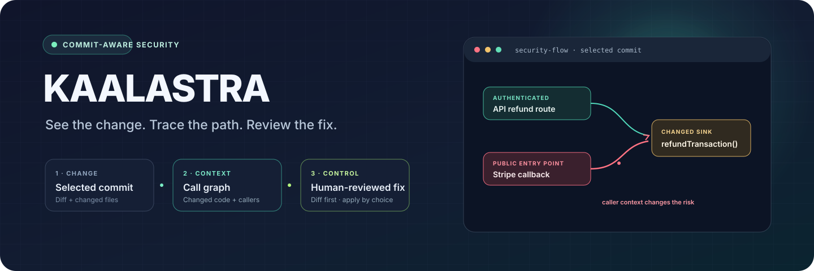

<strong>Commit-aware application security, inside VS Code.</strong>

See what changed. Trace who can reach it. Review a fix before it touches your code.

<strong>Hackathon prototype · MIT · VS Code 1.85+</strong>

> **Project in one sentence:** KaalAstra reviews a selected Git commit, combines changed-file security checks with repository call-graph context, and presents findings and human-reviewed fix proposals in Visual Studio Code.

## At a glance

| | |
|---|---|
| **Problem** | A risky code change can look harmless until you trace how the changed function is reached. |
| **Primary user** | Developers who want security feedback while reviewing code. |
| **Core idea** | Start with the commit diff, add focused caller context, then put evidence and a proposed fix beside the code. |
| **Interface** | Visual Studio Code extension, Python CLI, and an experimental local HTTP API. |
| **Demo application** | An intentionally vulnerable Express payment-gateway sample with a public webhook and refund flow. |
| **Current status** | Hackathon prototype. AI review and optional integrations depend on configured services. |
| **License** | MIT. |

## Contents

- [The problem](#the-problem-kaalastra-is-built-around)
- [Pune context and real-world examples](#why-this-matters-in-pune-and-beyond)
- [Demo and walkthrough](#the-demo-one-commit-two-paths-to-a-refund)
- [Implemented features and honest scope](#what-is-implemented)
- [Innovation and OpenAI sponsor fit](#why-this-is-innovative)
- [Architecture and data handling](#architecture)
- [Quickstart](#quickstart)
- [Dataset and model work](#dataset-and-model-work)
- [Development and roadmap](#development)
- [License](#license)

## The problem KaalAstra is built around

A changed function does not exist in isolation. An authorization check may be removed from a service because an API route already has middleware—while a second, public webhook calls the same service directly. A diff-only review may miss the path from the unauthenticated entry point to the sensitive operation.

KaalAstra focuses the review on a selected commit and uses a lightweight repository graph to add caller context. The goal is to make the security question concrete:

> **Which changed behavior matters, who can reach it, and what evidence supports the finding?**

## Why this matters in Pune and beyond

Our motivation includes a community-reported incident associated with **Vishwakarma Institute of Technology (VIT), Pune**: people in our college community described a Training and Placement Office email account as compromised and misused. We have not independently verified the incident's scope, method, or root cause, and we have found no public incident report establishing them. **We do not claim that a software vulnerability caused it or that KaalAstra would have detected it.** It shaped a practical question for us: when people trust a message because it appears to come from a familiar institution, how do we make software trust boundaries easier to inspect?

Public cases show why careful, evidence-led security work matters:

| Example | What the source reports | What we do **not** infer |
|---|---|---|
| **PHP security advisory** | CERT-In's April 2025 note describes multiple PHP vulnerabilities that could enable security bypass, remote code execution, data manipulation, or denial of service. | This is not evidence that the Pune college incident involved PHP. |
| **Node.js security release** | The Node.js project published July 2025 security fixes, including a path-normalization traversal bypass affecting active release lines. | A runtime advisory is not proof that a particular application is exploitable. |
| **Cyber-fraud investigation** | A July 2025 CBI case reported by PIB describes allegations that ₹3.81 crore reached a mule account in one day and was layered through other accounts. | This is not a claim that CBI systems were breached or that the fraud began with a code vulnerability. |
| **Railway ticketing abuse controls** | The Ministry of Railways reported deactivating 3.03 crore suspicious user IDs in 2025 and described anti-bot and account controls. | Suspicious account activity is not evidence of a railway database breach. |

Sources: [CERT-In PHP advisory](https://www.cert-in.org.in/s2cMainServlet?VLCODE=CIVN-2025-0063&pageid=PUBVLNOTES01) · [Node.js July 2025 security release](https://nodejs.org/en/blog/vulnerability/july-2025-security-releases) · [PIB report on the CBI case](https://www.pib.gov.in/PressReleaseIframePage.aspx?PRID=2149124&lang=2&reg=48) · [PIB report on Railway ticketing controls](https://www.pib.gov.in/PressReleasePage.aspx?PRID=2227511&lang=1&reg=6).

KaalAstra did not investigate these incidents. They are context for the problem, not evidence of product performance.

## The demo: one commit, two paths to a refund

The bundled Express sample contains an intentionally vulnerable payment flow:

- The regular <code>POST /refund</code> route uses authentication middleware.
- The public <code>POST /stripe-callback</code> route trusts an incoming event body, creates a system user with an admin role, and calls <code>refundTransaction</code>.
- The service has no longer-enforced role check, so the same sensitive function can be reached through a second path.

The graph's purpose is to make that contrast visible during a commit review.

~~~mermaid
flowchart LR
    A["Authenticated API route"] --> B["Authentication middleware"]
    B --> C["refundTransaction"]
    D["Public Stripe callback"] --> E["Unverified event payload"]
    E --> F["System user marked admin"]
    F --> C
    C --> G["Refund operation"]
    classDef safe fill:#123c39,stroke:#62e6bd,color:#eafff7
    classDef risk fill:#48242b,stroke:#ff7186,color:#fff1f3
    class A,B safe
    class D,E,F,G risk
~~~

This is a **teaching fixture**, not a live payment integration. Do not deploy the demo service or send real payment events to it.

### Demo walkthrough

1. Open the KaalAstra repository in VS Code and launch **Launch KaalAstra Extension**.
2. Run **KaalAstra: Scan Current Commit** or choose a recent commit in the sidebar.
3. Select **Hybrid** to review the commit diff with available local checks and graph context.
4. Open the graph view to inspect the public callback-to-refund path beside the authenticated API path.
5. On a finding, choose **Propose Fix**. KaalAstra asks before sending the affected file and finding to the selected coding provider.
6. Review the proposed edit in VS Code's diff view. The file changes only after you explicitly choose **Apply Edit**.
7. Run relevant tests and rescan. A proposal is not proof that the issue is fixed.

## What is implemented

| Capability | Current behavior |
|---|---|
| **Commit capture** | Reads a selected Git commit and its changed files. The VS Code picker lists recent commits. |
| **Changed-file checks** | Scans changed files for configured Semgrep rules and common hard-coded secret patterns. Semgrep must be installed separately; the Python requirements file does not install it. |
| **Repository context** | Builds a lightweight graph from JavaScript, TypeScript, and Python source, then focuses the result on changed components and upstream callers. This is a heuristic graph, not a complete language-semantic call graph. |
| **AI review** | Sends the selected commit diff plus focused graph context to the configured reviewer. With <code>HF_TOKEN</code>, the backend uses Hugging Face Inference Providers and defaults to <code>Qwen/Qwen2.5-Coder-7B-Instruct</code>; without it, Gemini can be used when <code>GEMINI_API_KEY</code> is configured. |
| **Review modes** | Hybrid combines graph context, local checks, and AI review. Baseline skips graph construction. FinSec runs the optional FinSec detector path. |
| **Fix proposals** | Offers OpenAI, Anthropic, or Gemini as a separate coding provider. Provider keys are stored in VS Code SecretStorage; applying an edit requires a second explicit confirmation. |
| **Security flow artifact** | Writes a readable <code>.graph</code> lifecycle summary and findings JSON under <code>.kaalastra</code> in the scanned repository. |
| **Advisory questions** | Provides an explicit Ask Tavily workflow. Automatic VS Code JSON scans do not wait on Tavily research. |
| **HTTP API** | The Python backend exposes local FastAPI endpoints, including <code>/health</code>, <code>/api/scan</code>, and an experimental <code>/api/scan/stream</code>. |

### Honest scope

KaalAstra is a prototype, not a full SAST or software-composition-analysis product.

- **Dependency CVE and malicious-package scanning is not implemented yet.** Dependency intelligence is a roadmap item.
- The repository graph uses lightweight parsing and call-name matching; it can miss dynamic dispatch, framework behavior, aliases, and cross-language flows.
- Semgrep results depend on a working Semgrep installation and network access for its rule packs where required.
- AI findings are hypotheses for human review. A clean result does not prove the commit or repository is secure.
- No published benchmark currently demonstrates detection accuracy, reduced false positives, or superiority to another product.
- The bundled demo is deliberately vulnerable and must remain a local teaching target.

## Why this is innovative

Most fast code checks answer **“What pattern matched?”** KaalAstra tries to add the next question: **“Who can reach the changed operation?”**

The differentiator is the review shape, not a claim of a new detection algorithm:

1. **Commit-first scope** keeps the AI review anchored to a concrete change.
2. **Caller context** can expose a public route that reaches a function whose normal API callers are authenticated.
3. **Evidence in the editor** links findings to files, lines, and a graph view.
4. **Human-controlled remediation** separates analysis, proposal, diff review, and application into distinct steps.

## OpenAI sponsor fit and judging evidence

KaalAstra is a developer-security tool, not an OpenAI model wrapper. OpenAI is one of the optional coding providers in the human-reviewed remediation workflow; the security-review backend can use Hugging Face or Gemini. This separation is intentional and visible in the product.

| Hackathon criterion | Weight | Evidence in this repository |
|---|---:|---|
| **Technical Implementation** | 30% | VS Code extension, Python CLI/backend, Git commit capture, changed-file checks, focused call graph, and a runnable Express security scenario. |
| **Innovation & Creativity** | 25% | The demo distinguishes a protected API path from a public webhook path into the same refund function, making caller context the central review question. |
| **Sponsor / Track Fit** | 25% | OpenAI is available as a coding provider for a proposal-and-review workflow. The user controls whether a file is sent, inspects the diff, and separately approves applying it. |
| **Execution & Completeness** | 20% | Setup and demo steps, a local sample target, CLI modes, visible limitations, and an explicit verify-after-fix loop. |

**What we are not claiming:** OpenAI powers the core vulnerability detector; the detector is benchmark-proven; dependency scanning is complete; fixes are automatically verified; or a clean scan guarantees safety.

## Architecture

~~~mermaid
flowchart TD
    DEV["Developer selects a commit"]
    GIT["Git capture: commit diff + changed files"]
    LOCAL["Changed-file checks: secrets + optional Semgrep"]
    GRAPH["Repository graph: changed components + callers"]
    AI["AI review: HF Inference or Gemini"]
    UI["VS Code findings + graph"]
    FIX["Optional coding proposal"]
    DIFF["Human reviews side-by-side diff"]
    APPLY["Explicit apply, then tests and rescan"]

    DEV --> GIT
    GIT --> LOCAL
    GIT --> GRAPH
    LOCAL --> AI
    GRAPH --> AI
    AI --> UI
    UI --> FIX
    FIX --> DIFF
    DIFF --> APPLY
~~~

### Data handling

- The backend loads <code>HF_TOKEN</code>, <code>GEMINI_API_KEY</code>, and <code>TAVILY_API_KEY</code> from the repository-root <code>.env</code>. Keep that file local and never commit credentials.
- When external AI review is enabled, the selected commit diff and focused graph context are sent to the configured review provider.
- The coding-agent workflow sends the affected file and finding only after its confirmation dialog. Keys are stored in VS Code SecretStorage, not the workspace or webview.
- Ask Tavily is a separate user-triggered workflow. Review provider and coding provider credentials are separate settings.
- Read your provider's terms and ensure you are permitted to send the relevant source code before enabling a cloud integration.

## Quickstart

### 1. Install backend dependencies

From the repository root:

~~~bash
python -m venv .venv
~~~

Activate the environment:

~~~powershell
.venv\Scripts\Activate.ps1
~~~

~~~bash
source .venv/bin/activate
~~~

Install the backend packages:

~~~bash
python -m pip install -r backend/requirements.txt
~~~

Copy <code>.env.example</code> to <code>.env</code>. Configure <code>HF_TOKEN</code> for Hugging Face review or <code>GEMINI_API_KEY</code> as the fallback provider. Add <code>TAVILY_API_KEY</code> only if you want the advisory workflow. Set the HF token to a Hugging Face token with Inference Providers access. The default review model can be changed with <code>HF_REVIEW_MODEL</code>.

Windows PowerShell:

~~~powershell
Copy-Item .env.example .env
~~~

macOS/Linux:

~~~bash
cp .env.example .env
~~~

### 2. Build and launch the VS Code extension

~~~bash
npm --prefix vscode-extension install
npm --prefix vscode-extension run compile
code .
~~~

In VS Code, open **Run and Debug**, choose **Launch KaalAstra Extension**, and press **F5**. The launch profile opens the bundled <code>demo-target</code> workspace. You can also open the KaalAstra panel and run **KaalAstra: Scan Current Commit**.

If Python is not found automatically, set <code>kaalastra.pythonPath</code> to the Python executable that has the backend requirements installed.

### 3. Run the CLI

Hybrid review:

~~~bash
python backend/cli.py scan demo-target --engine hybrid --no-verify
~~~

Diff-only baseline:

~~~bash
python backend/cli.py scan demo-target --engine baseline --json --no-verify
~~~

The CLI reads the selected commit (default <code>HEAD</code>). For a quick local run without external AI credentials, the backend returns local scanner findings and reports that AI review is unavailable.

### Optional: run the local API

~~~bash
python backend/server.py
~~~

The server binds to <code>127.0.0.1</code> and uses <code>KAALASTRA_PORT</code> (default <code>8000</code>). It provides <code>/health</code>, <code>/api/scan</code>, and experimental server-sent events at <code>/api/scan/stream</code>.

## Dataset and model work

The repository also contains bounded vulnerability-dataset preparation and an exploratory Kaggle QLoRA training workflow. This is research work, separate from the extension's runtime scanner.

| Source | Current use | Caveat |
|---|---|---|
| **DeltaSecommits** | 2,290 filtered vulnerable/fixed candidates; project-level train/validation/test split. | Candidate labels do not establish root cause, attack path, or exact vulnerable line. |
| **PrimeVul** | Paired C/C++ examples plus a separately curated strict pool. | Published paired splits share projects; they are not independent cross-project evidence. |
| **Patchwork CVE** | 15,904 metadata records for CVE/project indexing and exclusion. | Metadata only; generated analysis is not used as training code. |
| **SVEN** | Kept for evaluation fixtures. | Isolated from training data. |

The current v2 package contains 3,998 training, 504 validation, and 971 test examples before token filtering. A previous pilot detected 1 of 30 vulnerable examples; the v2 run has no measured result published here. These numbers describe dataset preparation, **not model accuracy**.

Details: [dataset preparation notes](datasets/README.md) · [Kaggle training guide](docs/KAGGLE_TRAINING.md) · [training audit](docs/TRAINING_AUDIT.md) · [dataset manifest](datasets/manifests/downloads.json).

## Development

~~~bash
npm --prefix vscode-extension run compile
python -m py_compile backend/*.py
~~~

The VS Code extension source is in <code>vscode-extension/src</code>; webview assets are in <code>vscode-extension/media</code>. The Python CLI and scanning pipeline are in <code>backend</code>. The example Express application is in <code>demo-target</code>. Dataset tooling and manifests live under <code>scripts</code> and <code>datasets</code>.

Contributions that improve changed-code coverage, graph accuracy, scanner reliability, explainability, latency, tests, or privacy disclosures are welcome. Please include reproduction steps and distinguish confirmed behavior from hypotheses.

## Roadmap

- Add dependency vulnerability and package-risk analysis.
- Improve parser coverage and graph precision across frameworks.
- Make scanner availability and partial-analysis states explicit in reports.
- Evaluate against held-out, independently sourced projects and publish reproducible metrics.
- Package the extension for reproducible installation and add end-to-end demo assets.

## License

MIT. See [LICENSE](LICENSE).

---

**Find the path. Understand the change. Review the fix.**

Built in Pune, India · Designed for developers everywhere

